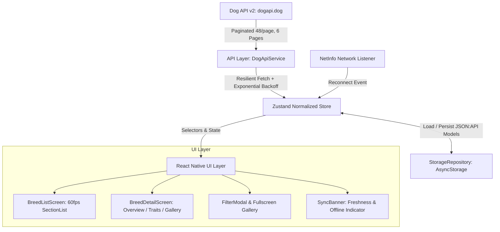
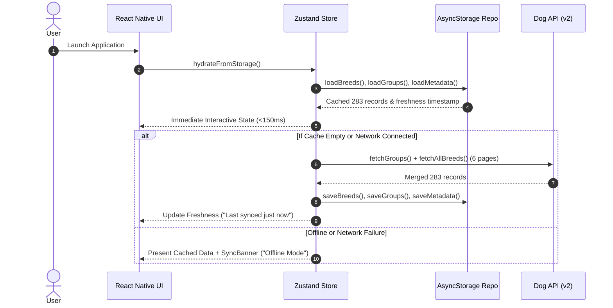

# Tripare AI – Dog Breed Explorer Architecture

## 1. System Overview

Tripare Dog Breed Explorer is a production-grade, offline-first mobile application built with **React Native (Expo SDK 58)** and **TypeScript (Strict Mode)**. It is architected specifically to handle real-world network instability, high payload richness across 283 dog breeds, responsive 60fps scrolling, and normalized data synchronization.



---

## 2. Data Flow Architecture: API ➔ Cache ➔ UI



---

## 3. Normalized Cache Schema Design

The store maintains a normalized structure to eliminate duplication, enable $O(1)$ lookups, and prevent unnecessary component tree re-renders:

```typescript
interface NormalizedDogState {
  // Normalized Entities
  breedsById: Record<string, Breed>;
  breedIds: string[];
  groupsById: Record<string, BreedGroup>;
  groupIds: string[];

  // Freshness & Synchronization
  lastSyncedAt: number | null;
  isSyncing: boolean;
  isPartialSync: boolean;
  syncError: string | null;
  syncProgress: { current: number; total: number; page: number } | null;
  isOffline: boolean;

  // Filter & Search Engine
  filters: {
    searchQuery: string;
    selectedGroupIds: string[];
    selectedSizes: ('small' | 'medium' | 'large' | 'giant')[];
    selectedCoatLengths: ('short' | 'medium' | 'long' | 'wire')[];
    hypoallergenicOnly: boolean | null;
    traitThresholds: TraitFilterThresholds;
    onlyFavorites: boolean;
  };

  // User Preferences
  favoriteIds: string[];
  themeMode: 'light' | 'dark' | 'system';
  viewMode: 'grouped' | 'flat';
}
```

---

## 4. Resilient Network & Synchronization Strategy

1. **Exponential Backoff with Jitter**:
   Network failures trigger retries with backoff delays ($T = 1000 \times 2^{\text{attempt}} + \text{jitter}$), avoiding server thundering herds.
2. **Intelligent Pagination Merger**:
   The Dog API paginates at 48 records per page ($283 / 48 = 6$ pages). Page 1 is fetched first to extract `meta.pagination.last`, followed by pages 2–6 with live progress callbacks (`syncProgress`).
3. **Partial Failure Recovery**:
   If an error occurs mid-stream (e.g., page 5 drops due to bad network), the system catches the failure gracefully, preserves all previously loaded records, sets `isPartialSync: true`, and informs the user through a non-intrusive `SyncBanner` with a one-tap retry CTA.
4. **Automatic Background Sync**:
   `NetInfo.addEventListener` detects offline-to-online transitions. When connectivity restores, an automatic background synchronization sequence runs silently to update the local cache.

---

## 5. UI Component Hierarchy

```
App
└── ErrorBoundary
    └── MainApp
        ├── Header (Debounced Search, Filter Counter Badge, Theme Toggle, Favorites)
        ├── SyncBanner (Relative Freshness, Offline Status, Retry Button)
        ├── BreedListScreen
        │   ├── SectionList / FlatList (Sticky Headers, 60fps virtualization)
        │   │   └── BreedCard (Thumbnail caching, Group badge, Size chip, Temperaments)
        │   └── FilterModal (Group multi-select, Size buckets, Coat, Hypoallergenic, Traits)
        └── BreedDetailScreen
            ├── Hero Header (Medium image, Title, Badges, Single-breed refresh)
            ├── Segmented Tabs (Overview | Traits | Gallery)
            ├── Overview Tab (Life span, Height/Weight ranges, Lineage, Coat, Clubs)
            ├── Traits Tab (11 Visual Scale Gauges + Temperament pills)
            └── Gallery Tab (Swipeable Carousel, Attributions, Fullscreen Zoom Modal)
```
